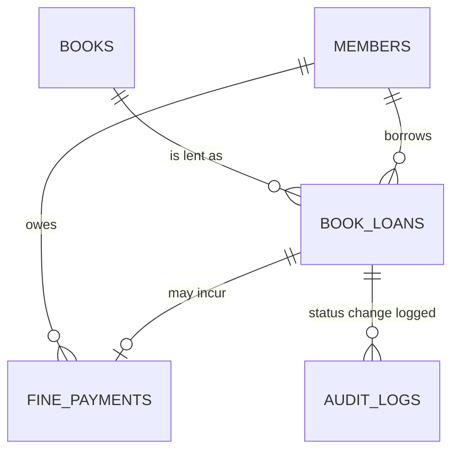

# Automated Library Management & Fine Tracking System (Oracle PL/SQL)

**Target:** Oracle Database 12c or later  
**Requirements:** No special privileges beyond `CREATE TABLE`, `CREATE SEQUENCE`, `CREATE PROCEDURE`, and `CREATE TRIGGER`.

## Files (Run in This Order)

| File | Purpose |
|---|---|
| `00_install.sql` | Runs files 01 to 05 in order (SQL*Plus / SQLcl) |
| `01_schema.sql` | Cleanup, 5 sequences, 5 tables, constraints, and indexes |
| `02_seed_data.sql` | 10 books, 6 members, 7 loans, 2 fines, and 4 audit rows |
| `03_triggers.sql` | Inventory guard and loan-status audit trigger |
| `04_pkg_library_mgmt.sql` | Package specification, package body, and standalone wrappers |
| `05_test_cases.sql` | Anonymous blocks: success, failure, and audit proof |

## Entity Model

## Business Rules

- Loan period: 14 days.
- Fine: 5 per overdue day, capped at 500 per loan (constants in the package specification).
- A member may borrow a book only if:
  - The member is `ACTIVE` and their membership has not expired.
  - Their outstanding fine balance is zero.
  - Their active loans are below `max_loans`.
  - The requested book exists.
  - At least one copy is available.
  - The member does not already hold that title.
- Active loans have status `ISSUED` or `OVERDUE`.
- Procedures never execute `COMMIT`.
- Each procedure rolls back to its own savepoint on failure.

## Error Codes

| Code | Exception | Raised When |
|---|---|---|
| -20001 | `ex_book_unavailable` | No copies left |
| -20002 | `ex_outstanding_fines` | Member has unpaid or partial fines |
| -20003 | `ex_max_loans_reached` | Member has reached the loan limit |
| -20004 | `ex_member_inactive` | Member is suspended or expired |
| -20005 | `ex_member_not_found` | Unknown member (`NO_DATA_FOUND`) |
| -20006 | `ex_book_not_found` | Unknown book (`NO_DATA_FOUND`) |
| -20007 | `ex_loan_not_found` | Unknown loan |
| -20008 | `ex_loan_already_closed` | Loan is not `ISSUED` or `OVERDUE` |
| -20009 | `ex_invalid_payment` | Invalid, excessive, or repeated payment |
| -20010 | `ex_negative_stock` | Trigger: `available_copies < 0` |
| -20011 | `ex_stock_exceeds_total` | Trigger: available copies exceed total copies |
| -20012 | `ex_duplicate_loan` | Member already holds this book |
| -20013 | `ex_data_integrity` | `TOO_MANY_ROWS` or unexpected missing data |
| -20014 | `ex_payment_not_found` | Unknown fine record |
| -20999 | `ex_unexpected_error` | Any other Oracle error, wrapped with context |

## Design Notes

### 1. Encapsulation
The following helper procedures and functions are private to the package body:

- `lock_member`
- `lock_book`
- `count_active_loans`
- `find_active_loan`
- `calc_fine`
- `write_audit`
- `assert_member_exists`

### 2. Concurrency
- Member and book rows are locked using `SELECT ... FOR UPDATE`.
- Locks are always acquired in the same order: member first, then book.
- This prevents two sessions from taking the last available copy or exceeding the loan limit.

### 3. Defence in Depth
- Stock rules are enforced using both a trigger (for friendly error messages) and a CHECK constraint.
- One active loan per member per title is enforced through a function-based unique index.

### 4. Error Passthrough
- `WHEN OTHERS` handlers re-raise errors in the range `-20999` to `-20001` without changing them.
- Other unexpected errors are wrapped as `-20999`.
- Business errors are therefore never masked by generic error handling.

### 5. Overloading
- `issue_book` is available with and without the `OUT p_loan_id` parameter.
- Standalone procedures and functions `issue_book`, `return_book`, and `get_member_fine_balance` delegate to the package.

## Expected Test Results (Fresh Seed)

1. **Test 1:** Stock changes from 3 → 2 → 3; fine balance remains 0.
2. **Test 2:** One loan is flagged as overdue; loan 5 is returned with a fine of 80.
3. **Test 3:** `ex_outstanding_fines` (-20002) is raised for Rohan.
4. **Test 4:** The following results are expected:
   - -20003
   - -20001
   - -20004
   - -20005
   - -20006
   - Then OK, followed by -20012, -20008, and -20007.
5. **Test 5:** Payment is blocked after 20; overpayment is rejected; payment is allowed after the full 50 is paid.
6. **Test 6:** -20010 and -20011 are raised by the trigger.
7. **Test 7:** Audit rows with `audit_id >= 1000` show runtime status changes. The integrity query returns no rows.

## Reset the Demo

To reset the database demo, rerun these scripts in order:

1. `01_schema.sql`
2. `02_seed_data.sql`

## Technologies Used

- Oracle Database 12c or later
- SQL
- PL/SQL
- Stored Procedures and Functions
- Database Triggers
- Sequences
- Constraints and Indexes
- Exception Handling
- Transaction Management
